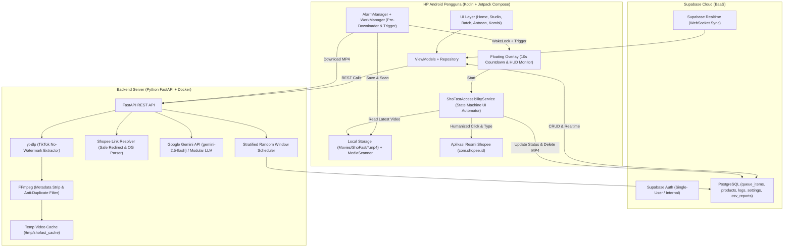
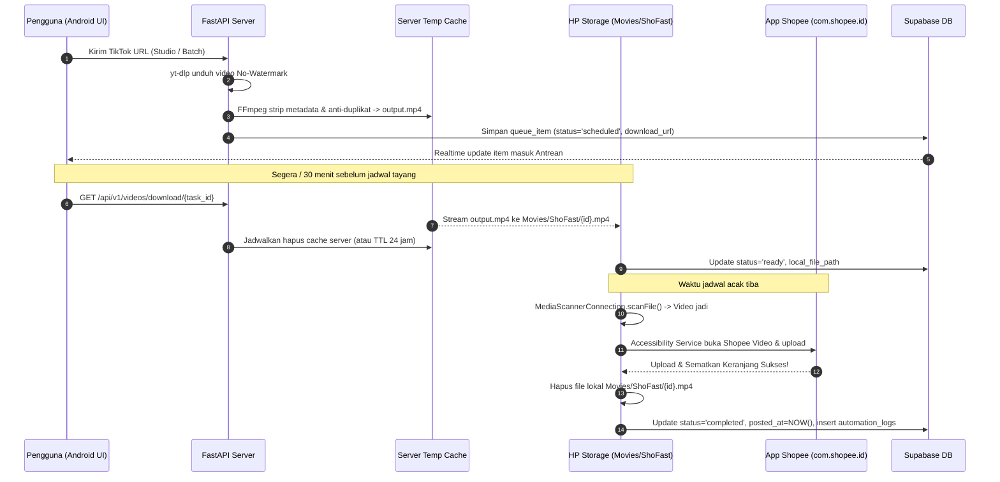

# 02 — Arsitektur Sistem Hybrid & Siklus Hidup Data (ShoFast)

Dokumen ini menjelaskan arsitektur teknis **Hybrid** yang menghubungkan Aplikasi Android Native (Kotlin), Backend Pemrosesan Media & AI (Python FastAPI), dan Database Real-Time (Supabase).

---

## 1. Diagram Arsitektur Keseluruhan

---

## 2. Pembagian Tanggung Jawab Komponen

### 2.1. Backend Server (`Python FastAPI`)
Berjalan sebagai container Docker (bisa di PC Windows lokal via Wi-Fi/Tailscale maupun di VPS Cloud Linux 24 jam):
- **Ekstraksi TikTok Tanpa Watermark**: Menggunakan `yt-dlp` untuk mengambil video kualitas tertinggi (1080p MP4 tanpa watermark TikTok) beserta metadata (author, judul, durasi).
- **Pipeline Anti-Duplikat FFmpeg**: Menghapus seluruh jejak EXIF/XMP/metadata TikTok dan memodifikasi sidik jari digital (*file hash* & *frame signature*) secara tidak kasat mata agar Shopee Video menganggap video 100% original.
- **Resolusi Link Produk Shopee Secara Aman**: Mengikuti redirect HTTP shortlink (`s.shopee.co.id`, `shp.ee`) dan membaca tag publik OpenGraph / struktur URL (`shop_id`, `item_id`, nama produk dari slug/title) tanpa mengakses private endpoint berproteksi anti-bot.
- **Generator AI Caption & Hashtag Unik**: Menggunakan `gemini-2.5-flash` (dengan arsitektur abstrak agar bisa beralih ke OpenAI/Groq lewat `.env`) untuk membuat hook, deskripsi singkat, CTA, dan hashtag yang unik pada setiap video.
- **Algoritma Penjadwalan Acak Anti-Bot**: Menghitung slot waktu acak terstratifikasi dalam rentang jam pilihan user (misal `09:00–17:00 WIB`).
- **Parser CSV Laporan Komisi**: Mengimpor file `.csv` resmi laporan Shopee Affiliate ke tabel `commission_snapshots` dan `commission_top_products`.

### 2.2. Supabase (Database & State Synchronization)
- Menyimpan state antrean (`queue_items`), produk tertaut (`queue_item_products`), pengaturan jadwal (`app_settings`), riwayat log (`automation_logs`), dan laporan komisi CSV (`commission_snapshots`).
- Memanfaatkan **Supabase Realtime** agar setiap perubahan status dari backend maupun eksekutor di HP langsung tercermin di layar Antrean dan Home Page tanpa perlu refresh manual.
- Menggunakan autentikasi simpel untuk penggunaan internal (email/password tunggal pada Supabase Auth + shared `X-API-Key` untuk komunikasi HP ke FastAPI).

### 2.3. Aplikasi Android (`Kotlin + Jetpack Compose`)
- **UI & Manajemen Antrean**: Implementasi 1:1 terhadap 5 desain Figma.
- **Background Pre-Downloader (`WorkManager`)**: Mengunduh file MP4 hasil FFmpeg dari FastAPI ke direktori publik HP (`Movies/ShoFast/`) dan membersihkan cache setelah upload sukses.
- **Exact Scheduler (`AlarmManager`)**: Membangunkan HP tepat pada menit & detik acak yang ditentukan, menyalakan layar via `WakeLock`, dan menampilkan Countdown Overlay 10 detik.
- **Accessibility Engine (`ShoFastAccessibilityService`)**: Mengendalikan UI aplikasi Shopee (`com.shopee.id`) secara terstruktur untuk memilih video terbaru dari galeri, menempelkan caption, mencari & mencentang 1–6 produk affiliate, mematikan auto-share medsos, dan menekan tombol Posting.

---

## 3. Siklus Hidup File Video & Penyimpanan (Storage Lifecycle)

Sesuai kesepakatan desain, penyimpanan Cloud permanen (S3/Supabase Storage) **tidak digunakan** untuk file MP4 guna menghemat kuota & biaya. Alur file video mengikuti diagram sekuens berikut:

### Keunggulan Siklus Ini:
1. **Hemat Storage Cloud**: Server hanya menyimpan video sementara di `/tmp/shofast_cache` (otomatis terhapus setelah diunduh HP atau melewati TTL maksimal 24 jam).
2. **Hemat Storage HP**: File MP4 di folder `Movies/ShoFast/` langsung dihapus oleh Android tepat setelah konfirmasi posting berhasil (`status = completed`).
3. **Resilien Saat Offline Sesaat**: Karena video sudah diunduh di lokal HP sebelum jam tayang (`status = ready`), proses eksekusi Shopee Video tidak terhambat lag download TikTok saat jadwal tiba.

---

## 4. Topologi Deployment (Fleksibel: Lokal PC & Cloud VPS)

Sistem dirancang portabel menggunakan **Docker & Docker Compose** agar pengguna dapat langsung koding dan menjalankan di laptop Windows maupun memindahkannya ke VPS 24 jam:

1. **Mode Development / Lokal PC (Windows)**:
   - Jalankan `docker compose up --build` (atau `uvicorn app.main:app --host 0.0.0.0 --port 8000`) di PC Windows (membutuhkan binary `ffmpeg` di PATH).
   - HP Android terhubung ke PC melalui **Wi-Fi Lokal yang sama** (`http://192.168.x.x:8000`) atau **Tailscale VPN** agar tetap aman diakses dari luar rumah tanpa port-forwarding router.
   - Base URL FastAPI dapat diubah langsung dari menu **Pengaturan Server** di dalam aplikasi Android ShoFast (tersimpan di `DataStore`) tanpa perlu compile ulang APK.
2. **Mode Produksi 24 Jam (VPS / Cloud)**:
   - Deploy folder `backend/` menggunakan `Dockerfile` ke VPS (Ubuntu/Debian), Railway, Fly.io, atau Render.
   - Pastikan HTTPS aktif (via Nginx / Caddy / Reverse Proxy platform) dan `API_SECRET_KEY` diaktifkan pada `.env`.
