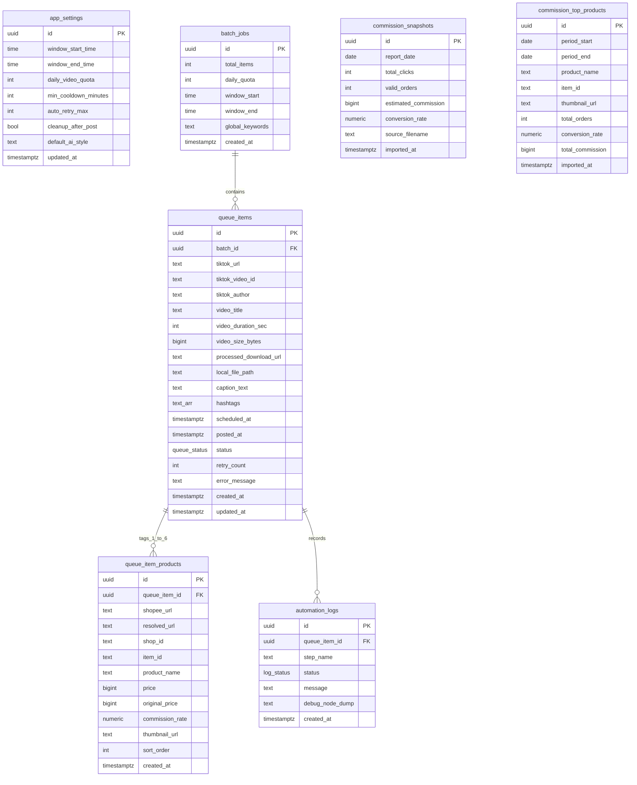

# 03 — Skema Database & DDL Supabase PostgreSQL (ShoFast)

Dokumen ini berisi skrip DDL SQL lengkap yang siap dijalankan langsung pada **Supabase SQL Editor** untuk membentuk seluruh tabel, tipe enum, relasi, indeks, trigger, dan konfigurasi *Realtime* bagi **ShoFast**.

---

## 1. Diagram Entitas Relasi (ERD)



---

## 2. Skrip DDL SQL Lengkap (Siap Eksekusi di Supabase)

Salin dan jalankan skrip di bawah ini secara berurutan pada Supabase SQL Editor.

```sql
-- =========================================================================
-- 1. EXTENSIONS & ENUM TYPES
-- =========================================================================
CREATE EXTENSION IF NOT EXISTS "pgcrypto";

DO $$ BEGIN
    CREATE TYPE queue_status AS ENUM (
        'scheduled',    -- Menunggu download atau menunggu jadwal tayang
        'downloading',  -- Android sedang mengunduh MP4 ke Movies/ShoFast
        'ready',        -- MP4 sudah ada di HP, siap dieksekusi Accessibility Service
        'processing',   -- Sedang dieksekusi di aplikasi Shopee
        'completed',    -- Berhasil tayang + keranjang tersemat + file lokal dihapus
        'failed'        -- Gagal permanen setelah melewati batas auto_retry_max
    );
EXCEPTION
    WHEN duplicate_object THEN null;
END $$;

DO $$ BEGIN
    CREATE TYPE log_status AS ENUM ('info', 'success', 'warning', 'error');
EXCEPTION
    WHEN duplicate_object THEN null;
END $$;

-- =========================================================================
-- 2. TABLES
-- =========================================================================

-- Pengaturan global untuk penggunaan pribadi/internal (single row default)
CREATE TABLE IF NOT EXISTS public.app_settings (
    id UUID PRIMARY KEY DEFAULT gen_random_uuid(),
    user_id UUID REFERENCES auth.users(id) ON DELETE CASCADE,
    window_start_time TIME NOT NULL DEFAULT '09:00:00',
    window_end_time TIME NOT NULL DEFAULT '17:00:00',
    daily_video_quota INTEGER NOT NULL DEFAULT 5 CHECK (daily_video_quota BETWEEN 1 AND 30),
    min_cooldown_minutes INTEGER NOT NULL DEFAULT 45 CHECK (min_cooldown_minutes >= 15),
    auto_retry_max INTEGER NOT NULL DEFAULT 2 CHECK (auto_retry_max BETWEEN 0 AND 5),
    cleanup_after_post BOOLEAN NOT NULL DEFAULT TRUE,
    default_ai_style TEXT NOT NULL DEFAULT 'racun shopee, singkat, hook kuat, emoji secukupnya',
    updated_at TIMESTAMPTZ NOT NULL DEFAULT NOW()
);

-- Catatan pengelompokan import dari Batch Ingestion Page
CREATE TABLE IF NOT EXISTS public.batch_jobs (
    id UUID PRIMARY KEY DEFAULT gen_random_uuid(),
    user_id UUID REFERENCES auth.users(id) ON DELETE CASCADE,
    total_items INTEGER NOT NULL DEFAULT 0,
    daily_quota INTEGER NOT NULL,
    window_start TIME NOT NULL,
    window_end TIME NOT NULL,
    global_keywords TEXT,
    created_at TIMESTAMPTZ NOT NULL DEFAULT NOW()
);

-- Antrean utama video yang akan & sudah diposting ke Shopee Video
CREATE TABLE IF NOT EXISTS public.queue_items (
    id UUID PRIMARY KEY DEFAULT gen_random_uuid(),
    user_id UUID REFERENCES auth.users(id) ON DELETE CASCADE,
    batch_id UUID REFERENCES public.batch_jobs(id) ON DELETE SET NULL,
    
    -- Metadata Video TikTok
    tiktok_url TEXT NOT NULL,
    tiktok_video_id TEXT,
    tiktok_author TEXT,
    video_title TEXT NOT NULL,
    video_duration_sec INTEGER DEFAULT 0,
    video_size_bytes BIGINT DEFAULT 0,
    thumbnail_url TEXT,
    
    -- Manajemen File Video
    backend_task_id TEXT,                -- ID cache file hasil FFmpeg di FastAPI
    processed_download_url TEXT,         -- Endpoint FastAPI untuk download oleh Android
    local_file_path TEXT,                -- Path di HP (contoh: Movies/ShoFast/sf_xxx.mp4)
    file_hash_sha256 TEXT,               -- Verifikasi integritas & bukti keunikan anti-duplikat
    
    -- Konten Postingan Shopee Video
    caption_text TEXT NOT NULL DEFAULT '',
    hashtags TEXT[] NOT NULL DEFAULT '{}',
    
    -- Penjadwalan & Eksekusi
    is_immediate BOOLEAN NOT NULL DEFAULT FALSE,
    scheduled_at TIMESTAMPTZ NOT NULL,
    posted_at TIMESTAMPTZ,
    status queue_status NOT NULL DEFAULT 'scheduled',
    retry_count INTEGER NOT NULL DEFAULT 0,
    error_message TEXT,
    
    created_at TIMESTAMPTZ NOT NULL DEFAULT NOW(),
    updated_at TIMESTAMPTZ NOT NULL DEFAULT NOW()
);

-- Produk Affiliate yang disematkan ke video (1 sampai 6 produk per queue_item)
CREATE TABLE IF NOT EXISTS public.queue_item_products (
    id UUID PRIMARY KEY DEFAULT gen_random_uuid(),
    queue_item_id UUID NOT NULL REFERENCES public.queue_items(id) ON DELETE CASCADE,
    shopee_url TEXT NOT NULL,
    resolved_url TEXT,
    shop_id TEXT,
    item_id TEXT,
    product_name TEXT NOT NULL,
    price BIGINT DEFAULT 0,
    original_price BIGINT DEFAULT 0,
    commission_rate NUMERIC(5,2) DEFAULT 0.00,
    thumbnail_url TEXT,
    sort_order INTEGER NOT NULL DEFAULT 1 CHECK (sort_order BETWEEN 1 AND 6),
    created_at TIMESTAMPTZ NOT NULL DEFAULT NOW()
);

-- Log detail per langkah Accessibility Service & Aktivitas Terakhir
CREATE TABLE IF NOT EXISTS public.automation_logs (
    id UUID PRIMARY KEY DEFAULT gen_random_uuid(),
    user_id UUID REFERENCES auth.users(id) ON DELETE CASCADE,
    queue_item_id UUID REFERENCES public.queue_items(id) ON DELETE CASCADE,
    step_name TEXT NOT NULL,             -- misal: 'LAUNCH_SHOPEE', 'ATTACH_PRODUCT', 'CLICK_POST'
    status log_status NOT NULL DEFAULT 'info',
    message TEXT NOT NULL,
    debug_node_dump TEXT,                -- Opsional: dump AccessibilityNodeInfo saat error
    created_at TIMESTAMPTZ NOT NULL DEFAULT NOW()
);

-- Ringkasan harian hasil Import CSV Resmi Shopee Affiliate (100% Aman Anti-Bot)
CREATE TABLE IF NOT EXISTS public.commission_snapshots (
    id UUID PRIMARY KEY DEFAULT gen_random_uuid(),
    user_id UUID REFERENCES auth.users(id) ON DELETE CASCADE,
    report_date DATE NOT NULL,
    total_clicks INTEGER NOT NULL DEFAULT 0,
    valid_orders INTEGER NOT NULL DEFAULT 0,
    estimated_commission BIGINT NOT NULL DEFAULT 0,
    conversion_rate NUMERIC(5,2) NOT NULL DEFAULT 0.00,
    source_filename TEXT,
    imported_at TIMESTAMPTZ NOT NULL DEFAULT NOW(),
    UNIQUE(user_id, report_date)
);

-- Daftar produk berpenghasilan tertinggi hasil Import CSV Resmi Shopee Affiliate
CREATE TABLE IF NOT EXISTS public.commission_top_products (
    id UUID PRIMARY KEY DEFAULT gen_random_uuid(),
    user_id UUID REFERENCES auth.users(id) ON DELETE CASCADE,
    period_start DATE NOT NULL,
    period_end DATE NOT NULL,
    product_name TEXT NOT NULL,
    item_id TEXT,
    thumbnail_url TEXT,
    total_orders INTEGER NOT NULL DEFAULT 0,
    conversion_rate NUMERIC(5,2) NOT NULL DEFAULT 0.00,
    total_commission BIGINT NOT NULL DEFAULT 0,
    imported_at TIMESTAMPTZ NOT NULL DEFAULT NOW()
);

-- =========================================================================
-- 3. INDEXES
-- =========================================================================
CREATE INDEX IF NOT EXISTS idx_queue_items_status_schedule 
    ON public.queue_items (status, scheduled_at ASC);

CREATE INDEX IF NOT EXISTS idx_queue_items_scheduled_date 
    ON public.queue_items (scheduled_at);

CREATE INDEX IF NOT EXISTS idx_queue_item_products_parent 
    ON public.queue_item_products (queue_item_id, sort_order);

CREATE INDEX IF NOT EXISTS idx_automation_logs_created 
    ON public.automation_logs (created_at DESC);

CREATE INDEX IF NOT EXISTS idx_commission_snapshots_date 
    ON public.commission_snapshots (report_date DESC);

-- =========================================================================
-- 4. TRIGGERS (Auto-update updated_at)
-- =========================================================================
CREATE OR REPLACE FUNCTION public.set_updated_at()
RETURNS TRIGGER AS $$
BEGIN
    NEW.updated_at = NOW();
    RETURN NEW;
END;
$$ LANGUAGE plpgsql;

DROP TRIGGER IF EXISTS trg_queue_items_updated_at ON public.queue_items;
CREATE TRIGGER trg_queue_items_updated_at
    BEFORE UPDATE ON public.queue_items
    FOR EACH ROW EXECUTE FUNCTION public.set_updated_at();

DROP TRIGGER IF EXISTS trg_app_settings_updated_at ON public.app_settings;
CREATE TRIGGER trg_app_settings_updated_at
    BEFORE UPDATE ON public.app_settings
    FOR EACH ROW EXECUTE FUNCTION public.set_updated_at();

-- =========================================================================
-- 5. ROW LEVEL SECURITY (RLS) & REALTIME
-- =========================================================================
-- Aktifkan RLS untuk keamanan meskipun penggunaan internal/pribadi
ALTER TABLE public.app_settings ENABLE ROW LEVEL SECURITY;
ALTER TABLE public.batch_jobs ENABLE ROW LEVEL SECURITY;
ALTER TABLE public.queue_items ENABLE ROW LEVEL SECURITY;
ALTER TABLE public.queue_item_products ENABLE ROW LEVEL SECURITY;
ALTER TABLE public.automation_logs ENABLE ROW LEVEL SECURITY;
ALTER TABLE public.commission_snapshots ENABLE ROW LEVEL SECURITY;
ALTER TABLE public.commission_top_products ENABLE ROW LEVEL SECURITY;

-- Kebijakan akses pemilik (authenticated user & service_role backend)
CREATE POLICY "Owner access app_settings" ON public.app_settings
    FOR ALL USING (auth.uid() = user_id OR user_id IS NULL);

CREATE POLICY "Owner access batch_jobs" ON public.batch_jobs
    FOR ALL USING (auth.uid() = user_id OR user_id IS NULL);

CREATE POLICY "Owner access queue_items" ON public.queue_items
    FOR ALL USING (auth.uid() = user_id OR user_id IS NULL);

CREATE POLICY "Owner access queue_item_products" ON public.queue_item_products
    FOR ALL USING (
        EXISTS (
            SELECT 1 FROM public.queue_items q
            WHERE q.id = queue_item_products.queue_item_id
              AND (q.user_id = auth.uid() OR q.user_id IS NULL)
        )
    );

CREATE POLICY "Owner access automation_logs" ON public.automation_logs
    FOR ALL USING (auth.uid() = user_id OR user_id IS NULL);

CREATE POLICY "Owner access commission_snapshots" ON public.commission_snapshots
    FOR ALL USING (auth.uid() = user_id OR user_id IS NULL);

CREATE POLICY "Owner access commission_top_products" ON public.commission_top_products
    FOR ALL USING (auth.uid() = user_id OR user_id IS NULL);

-- Aktifkan Supabase Realtime untuk sinkronisasi otomatis ke Android UI
ALTER PUBLICATION supabase_realtime ADD TABLE public.queue_items;
ALTER PUBLICATION supabase_realtime ADD TABLE public.automation_logs;
```

---

## 3. View Statistik Produktivitas Autopilot (Alternatif 100% Aman Pengganti Scraping Komisi)

Tambahkan View SQL berikut agar aplikasi Android dapat langsung mengambil statistik produktivitas tanpa perlu menghitung manual di sisi klien:

```sql
CREATE OR REPLACE VIEW public.v_posting_productivity_today AS
SELECT
    COUNT(*) FILTER (WHERE status = 'completed' AND posted_at::date = (NOW() AT TIME ZONE 'Asia/Jakarta')::date) AS posted_today,
    COUNT(*) FILTER (WHERE status IN ('scheduled', 'downloading', 'ready')) AS pending_queue,
    COUNT(*) FILTER (WHERE status = 'failed') AS failed_count,
    COALESCE(
        ROUND(
            (COUNT(*) FILTER (WHERE status = 'completed')::NUMERIC /
            NULLIF(COUNT(*) FILTER (WHERE status IN ('completed', 'failed')), 0)) * 100, 1
        ),
        100.0
    ) AS success_rate_percent,
    (
        SELECT COUNT(*)
        FROM public.queue_item_products p
        JOIN public.queue_items q ON q.id = p.queue_item_id
        WHERE q.status = 'completed'
          AND q.posted_at::date = (NOW() AT TIME ZONE 'Asia/Jakarta')::date
    ) AS affiliate_carts_tagged_today
FROM public.queue_items;
```
