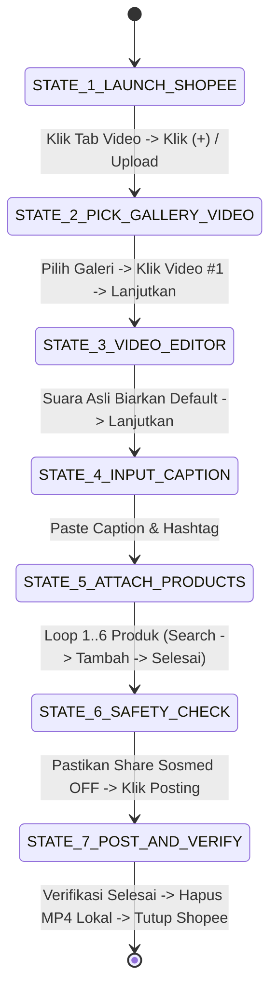

# 05 — Spesifikasi Android Accessibility Engine & Autopilot (Kotlin)

Dokumen ini merupakan panduan teknis mendalam untuk membangun otak otomatisasi pada aplikasi Android **ShoFast** menggunakan **Kotlin**, **AccessibilityService**, **MediaStore**, **AlarmManager**, **PowerManager.WakeLock**, dan **Floating Overlay**.

---

## 1. Dependensi & Arsitektur Android

- **Bahasa**: Kotlin (`1.9+` / `2.0+`), Coroutines & Flow
- **UI**: Jetpack Compose (Material 3)
- **Dependency Injection**: Hilt (`dagger.hilt.android`)
- **Database Client**: `supabase-kt` (`postgrest-kt`, `realtime-kt`, `gotrue-kt`)
- **Networking**: Ktor Client / Retrofit + OkHttp (untuk download MP4 stream & komunikasi FastAPI)
- **Background & Schedule**: `WorkManager` (Pre-download video) + `AlarmManager` (`setExactAndAllowWhileIdle` untuk eksekusi tepat di detik jadwal acak)
- **Target SDK**: `minSdk = 26` (Android 8.0), `targetSdk = 34` (Android 14)

---

## 2. Izin Wajib (`AndroidManifest.xml`)

```xml
<uses-permission android:name="android.permission.INTERNET" />
<uses-permission android:name="android.permission.ACCESS_NETWORK_STATE" />
<uses-permission android:name="android.permission.FOREGROUND_SERVICE" />
<uses-permission android:name="android.permission.FOREGROUND_SERVICE_DATA_SYNC" />
<uses-permission android:name="android.permission.FOREGROUND_SERVICE_SPECIAL_USE" />
<uses-permission android:name="android.permission.SYSTEM_ALERT_WINDOW" />
<uses-permission android:name="android.permission.WAKE_LOCK" />
<uses-permission android:name="android.permission.SCHEDULE_EXACT_ALARM" />
<uses-permission android:name="android.permission.REQUEST_IGNORE_BATTERY_OPTIMIZATIONS" />
<uses-permission android:name="android.permission.POST_NOTIFICATIONS" />

<!-- Akses penyimpanan media di Android 13+ dan Android <= 12 -->
<uses-permission android:name="android.permission.READ_MEDIA_VIDEO" />
<uses-permission android:name="android.permission.READ_EXTERNAL_STORAGE" android:maxSdkVersion="32" />
<uses-permission android:name="android.permission.WRITE_EXTERNAL_STORAGE" android:maxSdkVersion="29" />
```

### Konfigurasi `res/xml/accessibility_service_config.xml`
Penting: hanya dengarkan event dari aplikasi Shopee (`com.shopee.id`) saat mode autopilot aktif agar hemat baterai dan tidak membebani sistem.

```xml
<accessibility-service xmlns:android="http://schemas.android.com/apk/res/android"
    android:accessibilityEventTypes="typeWindowStateChanged|typeWindowContentChanged|typeViewScrolled"
    android:accessibilityFeedbackType="feedbackGeneric"
    android:accessibilityFlags="flagDefault|flagRetrieveInteractiveWindows|flagReportViewIds|flagIncludeNotImportantViews"
    android:canPerformGestures="true"
    android:canRetrieveWindowContent="true"
    android:description="@string/accessibility_service_desc"
    android:notificationTimeout="150"
    android:packageNames="com.shopee.id" />
```

---

## 3. Trik MediaStore & Persiapan Pra-Eksekusi

Aplikasi Shopee Video menampilkan daftar video galeri yang diurutkan berdasarkan **`DATE_ADDED` / `DATE_MODIFIED` terbaru** (posisi paling kiri-atas di grid Galeri). Oleh karena itu, sebelum `AccessibilityService` membuka aplikasi Shopee, Android **wajib** memastikan file MP4 target berada di posisi #1 paling baru:

1. **Unduh via WorkManager** ke folder `Movies/ShoFast/sf_{queueId}.mp4` menggunakan Android `MediaStore.Video.Media`.
2. **Tepat 3 detik sebelum meluncurkan Shopee**, perbarui `DATE_MODIFIED` / sentuh `lastModified = System.currentTimeMillis()` pada file tersebut lalu panggil:
   ```kotlin
   MediaScannerConnection.scanFile(
       context,
       arrayOf(localFile.absolutePath),
       arrayOf("video/mp4")
   ) { _, _ -> /* Siap muncul sebagai video #1 di Galeri Shopee */ }
   ```
3. **Auto-Cleanup Pasca Sukses**: Setelah upload berhasil (`status = completed`), hapus entri via `contentResolver.delete(mediaUri, null, null)` agar tidak tersisa sampah MP4 di galeri HP pengguna.

---

## 4. Mode Eksekusi Hybrid (WakeLock + Countdown Overlay 10 Detik)

Saat `AlarmManager` memicu waktu posting (atau pengguna menekan tombol `Jalankan Manual` di Home Page):
1. `AutopilotForegroundService` aktif dengan notifikasi persisten.
2. Periksa `PowerManager.isInteractive`. Jika layar mati, nyalakan layar sementara menggunakan `PowerManager.SCREEN_BRIGHT_WAKE_LOCK or PowerManager.ACQUIRE_CAUSES_WAKEUP`.
3. Periksa `KeyguardManager.isKeyguardLocked`. Jika HP terkunci PIN/Sidik jari (tidak bisa dibypass Android), kirim notifikasi berbunyi tinggi *"Buka Kunci Layar untuk Menjalankan Autopilot ShoFast"* dan tunggu hingga `ACTION_USER_PRESENT` atau tunda 5 menit. *(Rekomendasi: gunakan Smart Lock / HP khusus tanpa kunci layar agar 100% hands-free).*
4. Tampilkan **Floating Overlay Countdown (10 Detik)** menggunakan `WindowManager`:
   - Teks: `"Autopilot ShoFast akan memposting: Raket Nyamuk... dalam 9 dtk"`
   - Tombol: **`[Tunda 5 Menit]`**, **`[Batal]`**, **`[Jalan Sekarang]`**.
5. Setelah 10 detik (atau user klik *Jalan Sekarang*), overlay mengecil menjadi **Mini Floating HUD** di pojok atas layar yang menampilkan progress langkah (`1/7` s/d `7/7`) serta tombol darurat merah **`[STOP]`**.

---

## 5. State Machine `ShoFastAccessibilityService` (`com.shopee.id`)

Karena versi aplikasi Shopee (`com.shopee.id`) dapat mengubah `viewId` dari waktu ke waktu, mesin pencari node menggunakan **Strategi Pencarian Bertingkat (Multi-Strategy Node Finder)**:
1. Prioritas 1: Cari berdasarkan **Text / Content-Description** multi-bahasa (ID/EN), contoh: `["Posting", "Unggah", "Upload", "Post"]` (case-insensitive).
2. Prioritas 2: Cari berdasarkan **ClassName + Posisi / Hierarchy** (misal `EditText` pertama di halaman posting untuk Caption).
3. Prioritas 3: Jika node tidak mendukung `ACTION_CLICK` langsung, gunakan **`dispatchGesture()`** di titik tengah `Rect` node tersebut dengan **variasi acak `±12px`**.

### Diagram Alur State Machine



### Detail Setiap State & Penanganannya

| State | Nama Langkah | Aksi Otomatis di Aplikasi Shopee | Watchdog Timeout |
|---|---|---|---|
| **STATE 1** | `LAUNCH_SHOPEE` | Luncurkan `com.shopee.id` (intent `FLAG_ACTIVITY_NEW_TASK \| FLAG_ACTIVITY_CLEAR_TOP`). Jika muncul pop-up promo/iklan awal, cari tombol tutup (`X`, `Tutup`, `Nanti`) dan klik. Lalu ketuk tab **`Video`** / **`Live & Video`** di navigasi bawah, kemudian ketuk ikon **`+`** (buat video). | 25 dtk |
| **STATE 2** | `PICK_GALLERY_VIDEO` | Pada layar kamera Shopee Video, ketuk tombol **`Galeri`** / **`Unggah`** di pojok kanan bawah -> pilih filter tab **`Video`** -> ketuk item grid paling kiri-atas (index 0, file MP4 terbaru hasil `MediaScannerConnection`) -> ketuk **`Lanjutkan`** / **`Berikutnya`**. | 25 dtk |
| **STATE 3** | `VIDEO_EDITOR` | Sesuai preferensi pengguna, **biarkan Suara Asli video utuh** (tidak mengganti musik) -> langsung ketuk **`Lanjutkan`** / **`Berikutnya`** menuju halaman Detail Postingan. | 20 dtk |
| **STATE 4** | `INPUT_CAPTION` | Temukan `EditText` kolom deskripsi/caption (`Tambahkan deskripsi...` / `Tulis caption...`). Fokuskan node, lalu set teks menggunakan `ACTION_SET_TEXT` (atau fallback copy-paste via `ClipboardManager` + `ACTION_PASTE`) berisi `caption_text + " " + hashtags.joinToString(" ")`. Tutup keyboard (`performGlobalAction(GLOBAL_ACTION_BACK)` sekali jika keyboard menutupi tombol bawah). | 20 dtk |
| **STATE 5** | `ATTACH_PRODUCTS` | Ketuk baris **`Tambah Produk`** / **`Tambah Keranjang`**. Untuk setiap produk (1 s/d 6) dalam daftar `queue_item_products`:<br>1. Temukan kolom pencarian di halaman pilih produk.<br>2. Masukkan `resolved_url` (atau jika hasil kosong, fallback ketik 4–5 kata pertama `product_name`).<br>3. Tekan cari/enter -> tunggu daftar produk muncul (2.5–3.5 dtk) -> klik tombol **`Tambah`** / checkbox pada produk hasil teratas (prioritaskan yang memiliki kecocokan nama/komisi).<br>4. Setelah semua 1–6 produk tercentang, ketuk **`Selesai`** / **`Simpan`** untuk kembali ke halaman posting. | 30 dtk / produk |
| **STATE 6** | `PRE_POST_SAFETY_CHECK` | Pindai node toggle/switch berbagi otomatis (`WhatsApp`, `Instagram`, `Facebook`, `Simpan ke Galeri` opsional). Pastikan toggle berbagi ke media sosial eksternal dalam keadaan **`isChecked == false`**. Jika aktif, klik untuk mematikan. | 10 dtk |
| **STATE 7** | `POST_AND_VERIFY` | Ketuk tombol merah **`Posting`** / **`Upload`**. Tunggu indikator unggahan/toast sukses muncul (atau deteksi layar kembali ke feed Shopee Video dengan bar progres upload hilang/selesai, maksimal tunggu 45 detik tergantung ukuran file). Setelah terkonfirmasi: update status Supabase -> `completed`, simpan log sukses, hapus file MP4 lokal, dan buka kembali `MainActivity` ShoFast (atau matikan WakeLock). | 60 dtk |

---

## 6. Mesin Humanisasi Anti-Bot (`Humanizer.kt`)

Untuk menghindari deteksi pola robot oleh SDK keamanan internal Shopee:

```kotlin
object Humanizer {
    private val random = java.security.SecureRandom()

    /** Jeda acak natural antar klik atau transisi halaman (1.8 - 4.2 detik) */
    suspend fun humanDelay(minMs: Long = 1800L, maxMs: Long = 4200L) {
        val delayMs = minMs + (random.nextDouble() * (maxMs - minMs)).toLong()
        kotlinx.coroutines.delay(delayMs)
    }

    /** Ketuk node menggunakan gesture sentuhan nyata dengan jitter koordinat +-12px */
    fun tapNodeWithJitter(
        service: AccessibilityService,
        node: AccessibilityNodeInfo,
        onComplete: ((Boolean) -> Unit)? = null
    ) {
        val rect = android.graphics.Rect()
        node.getBoundsInScreen(rect)

        val jitterX = random.nextInt(25) - 12 // -12 .. +12 px
        val jitterY = random.nextInt(25) - 12
        val targetX = (rect.centerX() + jitterX).coerceIn(rect.left + 2, rect.right - 2).toFloat()
        val targetY = (rect.centerY() + jitterY).coerceIn(rect.top + 2, rect.bottom - 2).toFloat()

        val path = android.graphics.Path().apply { moveTo(targetX, targetY) }
        val gestureDuration = 65L + random.nextInt(55) // 65 - 120 ms durasi sentuh jari manusia
        val gesture = android.accessibilityservice.GestureDescription.Builder()
            .addStroke(android.accessibilityservice.GestureDescription.StrokeDescription(path, 0, gestureDuration))
            .build()

        service.dispatchGesture(gesture, object : AccessibilityService.GestureResultCallback() {
            override fun onCompleted(gestureDescription: android.accessibilityservice.GestureDescription?) {
                onComplete?.invoke(true)
            }
            override fun onCancelled(gestureDescription: android.accessibilityservice.GestureDescription?) {
                onComplete?.invoke(false)
            }
        }, null)
    }
}
```

---

## 7. Penanganan Error & Auto-Retry

- **Jika State Timeout (> 25 detik)** atau muncul Captcha/Login dibutuhkan di layar Shopee:
  1. `AccessibilityService` langsung **BERHENTI** (tidak memaksa klik terus-menerus!).
  2. Mengambil ringkasan pohon node (`dumpNodeTreeSummary`) untuk diagnostik dan menyimpannya ke `automation_logs`.
  3. Jika pesan mengandung kata kunci `"Verifikasi"` / `"Captcha"` / `"Login"`, hentikan auto-retry dan kirim notifikasi merah ke pengguna untuk dicek manual (keamanan akun prioritas #1).
  4. Jika error bersifat transien (jaringan lambat, pop-up iklan Shopee menghalangi, UI telat render) dan `retry_count < auto_retry_max (2)`, jadwalkan ulang eksekusi via `AlarmManager` **5 menit + jitter acak (20–90 detik)** ke depan.
  5. Jika sudah mencapai batas `retry_count >= 2`, tandai item `status = 'failed'` sehingga muncul di tab `Gagal` pada halaman Antrean.
