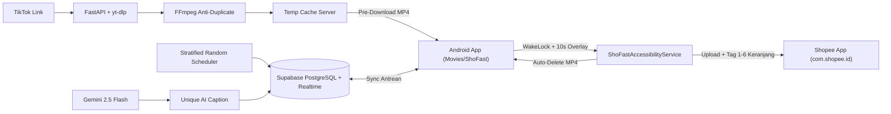

# ⚡ ShoFast — Sistem Otomasi Shopee Affiliate Video

[](https://github.com/alzahraramadhani/ShoFast/actions/workflows/repo-guard.yml)
[](https://github.com/alzahraramadhani/ShoFast/actions/workflows/backend-ci.yml)
[](https://github.com/alzahraramadhani/ShoFast/actions/workflows/android-ci.yml)
[](https://github.com/alzahraramadhani/ShoFast/actions/workflows/release.yml)
[](LICENSE)

> **ShoFast** adalah sistem otomasi **Shopee Affiliate Video** berbasis arsitektur *Hybrid* (**Native Android Kotlin + Python FastAPI + Supabase**) yang mengunduh video TikTok tanpa watermark, membersihkan sidik jari media (anti-duplikat via FFmpeg), menghasilkan caption & hashtag unik menggunakan Google Gemini AI, menjadwalkan waktu posting secara acak terstratifikasi (*anti-bot*), serta mengunggah video dan menyematkan **1–6 keranjang produk affiliate** secara otomatis ke aplikasi resmi Shopee Android (`com.shopee.id`).

---

## ✨ Fitur Utama

- **🎬 TikTok Clean HD Downloader (`yt-dlp`)** — Mengunduh video dari tautan `vt.tiktok.com` maupun `tiktok.com` tanpa watermark dalam resolusi hingga 1080p MP4.
- **🛡️ Pipeline Anti-Duplikat FFmpeg** — Menghapus seluruh metadata/EXIF TikTok (`-map_metadata -1`) serta menerapkan mutasi mikro imperceptible agar *file hash* (SHA-256) dan sidik jari visual 100% baru di mata algoritma Shopee Video.
- **🤖 Smart Per-Video AI Caption (`gemini-2.5-flash`)** — Menghasilkan `[HOOK]`, body persuasif bergaya *racun Shopee*, CTA, dan `#Hashtags` yang **unik untuk tiap baris video** bahkan saat mode *Batch Ingestion*.
- **🎲 Jadwal Acak Anti-Bot (*Stratified Random Windowing*)** — Menentukan target kuota harian (misal `5 video/hari`) di dalam rentang jam aktif pilihan pengguna (misal `09:00 – 17:00 WIB`). Sistem otomatis membagi rentang menjadi beberapa jendela waktu dengan menit & detik acak serta jeda cooldown aman (min. 45 menit) agar pola posting tidak pernah terdeteksi sebagai bot.
- **🛒 Otomasi Keranjang Affiliate 1–6 Produk (`AccessibilityService`)** — Menyematkan 1 hingga 6 tautan produk Shopee ke dalam keranjang video otomatis dengan *humanized delay* (1.8–4.2 detik acak) & variasi koordinat ketukan (`±12px`).
- **📱 Hybrid Execution Mode (`WakeLock` + Overlay 10 Detik)** — Membangunkan layar saat waktu jadwal tiba, menampilkan hitung mundur interaktif 10 detik (`Tunda 5 Menit` / `Batal`), dan menampilkan Mini Floating HUD saat eksekusi berjalan.
- **🧹 Zero Permanent Cloud Storage & Auto-Cleanup** — File MP4 hanya disimpan sementara di cache server dan `Movies/ShoFast/` di HP, lalu otomatis terhapus segera setelah status unggahan berhasil (`completed`).
- **📊 Laporan Komisi 100% Aman (`Import CSV Shopee`)** — Tidak melakukan scraping akun atau private API Shopee; statistik komisi, grafik performa harian, dan produk paling menghasilkan diimpor secara aman dari file CSV resmi Shopee Affiliate.

---

## 🔒 Prinsip Keamanan Anti-Bot (Wajib)

Demi menjaga keamanan penuh akun Shopee Affiliate pengguna dari deteksi `af-ac-enc-dat`, `x-sap-ri`, atau pembatasan akun (`F01`/`D01`):
1. **Tanpa Private API / Cookie Scraping**: ShoFast tidak pernah menyadap cookie WebView atau menembak API internal Shopee.
2. **Tanpa Scraping Layar Komisi**: Pengecekan komisi real-time dilakukan manual di aplikasi Shopee; ShoFast hanya membaca file CSV ekspor resmi & statistik produktivitas posting lokal.
3. **Interaksi Menyerupai Manusia**: Jeda acak non-konstan, sentuhan ber-jitter, verifikasi toggle auto-share sosial media selalu `OFF`, serta otomatis berhenti seketika apabila terdeteksi layar Captcha atau verifikasi login.

---

## 🏗️ Arsitektur Sistem



### Tech Stack

| Lapisan | Teknologi |
|---|---|
| **Mobile App & Executor** | Native Android **Kotlin**, **Jetpack Compose** (Material 3), Hilt, Coroutines, `supabase-kt`, Ktor, WorkManager, AlarmManager, MediaStore, `AccessibilityService`, `SYSTEM_ALERT_WINDOW` |
| **Backend Server** | **Python 3.11+**, **FastAPI**, `yt-dlp`, **FFmpeg**, **Google Gemini API (`gemini-2.5-flash`)**, Docker |
| **Database & Realtime** | **Supabase** (PostgreSQL, Auth Single-User/Internal, Realtime WebSocket) |
| **CI/CD & DevOps** | **GitHub Actions** (Repo Guard, Ruff, Pytest, Docker Buildx, Gradle Lint/Unit Test/APK Artifact, GHCR Release) |

---

## 🎨 Desain UI/UX (5 Layar Figma)

Seluruh layar aplikasi Android dirancang mengikuti 5 referensi visual di [`Docs/Design Figma/`](Docs/Design%20Figma):

| Halaman | Deskripsi Fungsional | Referensi Desain |
|---|---|---|
| **Home** | Status Accessibility Service, Ringkasan Hari Ini, Jadwal Berikutnya, Aksi Cepat, & Aktivitas Terakhir | [`Home Page.jpg`](Docs/Design%20Figma/Home%20Page.jpg) |
| **Content Studio** | Pembuatan posting satuan: Fetch TikTok Clean HD, AI Caption, Multi-Produk (1–6), & Posting Langsung | [`Studio Page.jpg`](Docs/Design%20Figma/Studio%20Page.jpg) |
| **Batch Ingestion** | Input multi-baris (`Link TikTok \| Link Shopee 1, 2`), AI caption unik per video, & **Jadwal Acak Rentang Jam** | [`Batch Page.jpg`](Docs/Design%20Figma/Batch%20Page.jpg) |
| **Manajemen Antrean** | Filter status (`Terjadwal`, `Diproses`, `Berhasil`, `Gagal`), retry otomatis/manual, & aksi cepat | [`Antrean Page.jpg`](Docs/Design%20Figma/Antrean%20Page.jpg) |
| **Komisi Affiliate** | **Import CSV Resmi Shopee**, Grafik Performa Harian, & Produk Paling Menghasilkan (`CR %`) | [`Komisi Page.jpg`](Docs/Design%20Figma/Komisi%20Page.jpg) |

---

## 📁 Struktur Monorepo

```text
ShoFast/
├── .github/
│   ├── ISSUE_TEMPLATE/
│   │   ├── bug_report.yml
│   │   └── feature_request.yml
│   ├── workflows/
│   │   ├── repo-guard.yml          # Cek secret leak, YAML & format Conventional Commits
│   │   ├── backend-ci.yml          # Ruff lint, Pytest & Docker build verification
│   │   ├── android-ci.yml          # Gradle lint, unit test & Debug APK artifact
│   │   └── release.yml             # Publish Docker image ke GHCR & GitHub Release APK
│   ├── CODEOWNERS
│   └── PULL_REQUEST_TEMPLATE.md
├── Docs/
│   ├── Design Figma/               # 5 screenshot referensi UI
│   ├── 01_PRD_AND_FEATURES.md
│   ├── 02_SYSTEM_ARCHITECTURE.md
│   ├── 03_DATABASE_SCHEMA.md
│   ├── 04_BACKEND_API_SPEC.md
│   ├── 05_ANDROID_ACCESSIBILITY_ENGINE.md
│   ├── 06_UI_UX_DESIGN_SYSTEM.md
│   └── 07_DEVELOPMENT_ROADMAP.md
├── backend/                        # Python FastAPI + Docker (Fase 1–2)
├── android/                        # Kotlin + Jetpack Compose App (Fase 3–6)
├── AGENTS.md                       # Aturan arsitektur, anti-bot & auto-push untuk AI Agent
├── CONTRIBUTING.md                 # Panduan GitHub Flow & Conventional Commits
├── LICENSE                         # MIT License
├── .gitattributes
├── .gitignore
└── README.md
```

---

## 🚀 Quick Start (Panduan Setup)

### 1. Setup Database Supabase
1. Buat proyek baru di [Supabase](https://supabase.com).
2. Buka **SQL Editor** dan jalankan seluruh skrip DDL pada [`Docs/03_DATABASE_SCHEMA.md`](Docs/03_DATABASE_SCHEMA.md).
3. Catat `SUPABASE_URL`, `SUPABASE_ANON_KEY`, dan `SUPABASE_SERVICE_ROLE_KEY`.

### 2. Menjalankan Backend FastAPI (Lokal / VPS via Docker)
```bash
git clone https://github.com/alzahraramadhani/ShoFast.git
cd ShoFast/backend
cp .env.example .env
# Isi API_SECRET_KEY, SUPABASE_URL, SUPABASE_SERVICE_ROLE_KEY, dan GEMINI_API_KEY
docker compose up --build -d
```
Server akan berjalan pada port `8000` (Swagger UI tersedia di `http://localhost:8000/docs`).

### 3. Build Aplikasi Android
```bash
cd ShoFast/android
./gradlew assembleDebug
```
Instal APK hasil build di perangkat Android target, lalu aktifkan izin **Accessibility Service**, **Tampil di Atas Aplikasi Lain (Overlay)**, **Alarm Tepat Waktu**, dan **Abaikan Optimasi Baterai**.

---

## 🔄 Git Workflow & CI/CD Pipelines

Proyek ini menerapkan **GitHub Flow** dan **Conventional Commits** (`<type>(<scope>): <subject>`). Seluruh detail tata cara kontribusi tersedia di [`CONTRIBUTING.md`](CONTRIBUTING.md).

| Workflow | Pemicu | Tugas Utama |
|---|---|---|
| `repo-guard.yml` | Setiap `push` & `pull_request` | Memblokir file rahasia/media (`.env`, `.jks`, `.mp4`, `.csv`), validasi YAML, dan memeriksa format *Conventional Commits*. |
| `backend-ci.yml` | Perubahan di `backend/**` | Menjalankan `ruff check`, `pytest`, dan verifikasi build `Dockerfile` backend. |
| `android-ci.yml` | Perubahan di `android/**` | Menjalankan `lintDebug`, `testDebugUnitTest`, `assembleDebug`, dan menyimpan artifact Debug APK. |
| `release.yml` | Push tag SemVer `v*.*.*` | Mempublikasikan container image ke `ghcr.io/alzahraramadhani/shofast-backend` & merilis APK di GitHub Releases. |

---

## 📚 Indeks Dokumentasi Lengkap

- [`AGENTS.md`](AGENTS.md) — Panduan utama AI agent, aturan anti-bot & aturan wajib auto-push Git
- [`CONTRIBUTING.md`](CONTRIBUTING.md) — Standar branching, Conventional Commits & rilis
- [`Docs/01_PRD_AND_FEATURES.md`](Docs/01_PRD_AND_FEATURES.md) — PRD & spesifikasi 5 halaman
- [`Docs/02_SYSTEM_ARCHITECTURE.md`](Docs/02_SYSTEM_ARCHITECTURE.md) — Arsitektur Hybrid & siklus hidup video
- [`Docs/03_DATABASE_SCHEMA.md`](Docs/03_DATABASE_SCHEMA.md) — Skema database & DDL SQL Supabase
- [`Docs/04_BACKEND_API_SPEC.md`](Docs/04_BACKEND_API_SPEC.md) — REST API FastAPI, FFmpeg & Stratified Random Scheduler
- [`Docs/05_ANDROID_ACCESSIBILITY_ENGINE.md`](Docs/05_ANDROID_ACCESSIBILITY_ENGINE.md) — State machine Accessibility Service & Humanizer
- [`Docs/06_UI_UX_DESIGN_SYSTEM.md`](Docs/06_UI_UX_DESIGN_SYSTEM.md) — Design tokens & komponen Jetpack Compose
- [`Docs/07_DEVELOPMENT_ROADMAP.md`](Docs/07_DEVELOPMENT_ROADMAP.md) — Struktur monorepo & roadmap implementasi Fase 1–6

---

<p align="center">
  <strong>Copyright © 2026 ShoFast</strong><br/>
  Dikembangkan oleh <strong>Al Zahra Ramadhani</strong> dan <strong>Dalvin Widya Purnama</strong>.<br/>
  Dirilis di bawah <a href="LICENSE">MIT License</a>.
</p>
