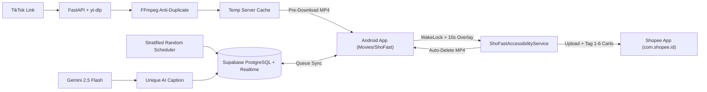

# ⚡ ShoFast — Shopee Affiliate Video Automation System

[](https://github.com/alzahraramadhani/ShoFast/actions/workflows/repo-guard.yml)
[](https://github.com/alzahraramadhani/ShoFast/actions/workflows/backend-ci.yml)
[](https://github.com/alzahraramadhani/ShoFast/actions/workflows/android-ci.yml)
[](https://github.com/alzahraramadhani/ShoFast/actions/workflows/release.yml)
[](LICENSE)

> **ShoFast** is a **Shopee Affiliate Video** automation system built on a *Hybrid* architecture (**Native Android Kotlin + Python FastAPI + Supabase**). It downloads TikTok videos without watermarks, scrubs media fingerprints via FFmpeg (anti-duplicate), generates unique AI captions and hashtags with Google Gemini, schedules uploads using stratified random time windows (*anti-bot*), and automatically publishes videos with **1–6 affiliate product carts** attached inside the official Shopee Android app (`com.shopee.id`).

---

## ✨ Key Features

- **🎬 TikTok Clean HD Downloader (`yt-dlp`)** — Downloads videos from both `vt.tiktok.com` short links and `tiktok.com` URLs without watermarks in up to 1080p MP4 quality.
- **🛡️ FFmpeg Anti-Duplicate Pipeline** — Strips all TikTok metadata/EXIF tags (`-map_metadata -1`) and applies imperceptible micro-mutations so the resulting SHA-256 hash and visual fingerprint are 100% unique to Shopee Video's deduplication engine.
- **🤖 Smart Per-Video AI Captions (`gemini-2.5-flash`)** — Generates `[HOOK]`, persuasive review body, CTA, and `#Hashtags` that are **unique for every individual video**, even in *Batch Ingestion* mode.
- **🎲 Anti-Bot Stratified Random Scheduler** — Users configure a daily upload quota (e.g., `5 videos/day`) and an active time window (e.g., `09:00 – 17:00 WIB`). The scheduler divides the window into balanced buckets, enforces a safe minimum cooldown (`>= 45 minutes`), and picks randomized minutes and seconds to prevent robotic posting patterns.
- **🛒 Automated 1–6 Affiliate Cart Tagging (`AccessibilityService`)** — Searches and attaches 1 to 6 Shopee affiliate products per video inside `com.shopee.id` using humanized delays (1.8–4.2s random) and jittered tap coordinates (`±12px`).
- **📱 Hybrid Execution Mode (`WakeLock` + 10s Overlay)** — Wakes the device screen at scheduled times, displays a 10-second interactive countdown overlay (`Snooze 5 Min` / `Cancel`), and shows a Mini Floating HUD during execution.
- **🧹 Zero Permanent Cloud Storage & Auto-Cleanup** — Processed MP4 files are only cached temporarily on the server and downloaded to `Movies/ShoFast/` on the phone, then automatically deleted immediately after upload completion (`completed`).
- **📊 100% Safe Commission Reporting (`Shopee CSV Import`)** — Zero account scraping or private API calls; earnings summaries, daily performance charts, and top-performing products are safely imported from official Shopee Affiliate CSV reports alongside local posting productivity metrics.

---

## 🔒 Anti-Bot Security Principles (Strict Rules)

To protect the user's Shopee Affiliate account from `af-ac-enc-dat`, `x-sap-ri` anti-bot flags, or account restrictions (`F01`/`D01`):
1. **No Private API or Cookie Scraping**: ShoFast never intercepts WebView cookies or calls Shopee's private internal APIs.
2. **No Commission Screen Scraping**: Real-time commission balances are checked manually inside the Shopee app; ShoFast only parses officially exported CSV reports and local posting statistics.
3. **Human-Like Automation**: Randomized non-static schedules, natural delays, coordinate jitter, external social auto-share toggles verified `OFF`, and instant abort whenever a Captcha or login verification prompt appears.

---

## 🏗️ System Architecture



### Tech Stack

| Layer | Technology |
|---|---|
| **Mobile App & Executor** | Native Android **Kotlin**, **Jetpack Compose** (Material 3), Hilt, Coroutines, `supabase-kt`, Ktor, WorkManager, AlarmManager, MediaStore, `AccessibilityService`, `SYSTEM_ALERT_WINDOW` |
| **Backend Server** | **Python 3.11+**, **FastAPI**, `yt-dlp`, **FFmpeg**, **Google Gemini API (`gemini-2.5-flash`)**, Docker |
| **Database & Realtime** | **Supabase** (PostgreSQL, Single-User/Internal Auth, Realtime WebSockets) |
| **CI/CD & DevOps** | **GitHub Actions** (Repo Guard, Ruff, Pytest, Docker Buildx, Gradle Lint/Unit Test/APK Artifact, GHCR Release) |

---

## 🎨 UI/UX Design (5 Figma Screens)

All Android screens follow the visual design references located in [`Docs/Design Figma/`](Docs/Design%20Figma):

| Screen | Functional Overview | Design Reference |
|---|---|---|
| **Home** | Accessibility Service status, Today's Summary, Next Scheduled Post, Quick Actions, & Recent Activity | [`Home Page.jpg`](Docs/Design%20Figma/Home%20Page.jpg) |
| **Content Studio** | Single-post creation: Clean HD TikTok fetch, AI Caption, Multi-Product Tagger (1–6), & Immediate Post toggle | [`Studio Page.jpg`](Docs/Design%20Figma/Studio%20Page.jpg) |
| **Batch Ingestion** | Multi-line input (`TikTok Link \| Shopee Link 1, 2`), per-video unique AI captions, & **Random Time Window Scheduler** | [`Batch Page.jpg`](Docs/Design%20Figma/Batch%20Page.jpg) |
| **Queue Manager** | Status filter tabs (`Scheduled`, `Processing`, `Completed`, `Failed`), auto/manual retry, & quick actions | [`Antrean Page.jpg`](Docs/Design%20Figma/Antrean%20Page.jpg) |
| **Affiliate Commission** | **Official Shopee CSV Import**, Daily Performance Bar Chart, & Top Earning Products (`CR %`) | [`Komisi Page.jpg`](Docs/Design%20Figma/Komisi%20Page.jpg) |

---

## 📁 Monorepo Structure

```text
ShoFast/
├── .github/
│   ├── ISSUE_TEMPLATE/
│   │   ├── bug_report.yml
│   │   └── feature_request.yml
│   ├── workflows/
│   │   ├── repo-guard.yml          # Secret leak scan, YAML check & Conventional Commits enforcement
│   │   ├── backend-ci.yml          # Ruff lint, Pytest & Docker build verification
│   │   ├── android-ci.yml          # Gradle lint, unit tests & Debug APK artifact
│   │   └── release.yml             # Publish Docker image to GHCR & GitHub Release APK
│   ├── CODEOWNERS
│   └── PULL_REQUEST_TEMPLATE.md
├── Docs/
│   ├── Design Figma/               # 5 UI visual design references
│   ├── 01_PRD_AND_FEATURES.md
│   ├── 02_SYSTEM_ARCHITECTURE.md
│   ├── 03_DATABASE_SCHEMA.md
│   ├── 04_BACKEND_API_SPEC.md
│   ├── 05_ANDROID_ACCESSIBILITY_ENGINE.md
│   ├── 06_UI_UX_DESIGN_SYSTEM.md
│   └── 07_DEVELOPMENT_ROADMAP.md
├── backend/                        # Python FastAPI + Docker (Phase 1–2)
├── android/                        # Kotlin + Jetpack Compose App (Phase 3–6)
├── AGENTS.md                       # AI coding agent instructions, anti-bot & auto-push rules
├── CONTRIBUTING.md                 # GitHub Flow & Conventional Commits guide
├── LICENSE                         # MIT License
├── .gitattributes
├── .gitignore
└── README.md
```

---

## 🚀 Quick Start

### 1. Supabase Database Setup
1. Create a new project in [Supabase](https://supabase.com).
2. Open the **SQL Editor** and execute the complete DDL script from [`Docs/03_DATABASE_SCHEMA.md`](Docs/03_DATABASE_SCHEMA.md).
3. Save your `SUPABASE_URL`, `SUPABASE_ANON_KEY`, and `SUPABASE_SERVICE_ROLE_KEY`.

### 2. Run the FastAPI Backend (Local PC or VPS via Docker)
```bash
git clone https://github.com/alzahraramadhani/ShoFast.git
cd ShoFast/backend
cp .env.example .env
# Fill in API_SECRET_KEY, SUPABASE_URL, SUPABASE_SERVICE_ROLE_KEY, and GEMINI_API_KEY
docker compose up --build -d
```
The server listens on port `8000` (interactive Swagger docs available at `http://localhost:8000/docs`).

### 3. Build the Android App
```bash
cd ShoFast/android
./gradlew assembleDebug
```
Install the generated APK on your target Android device and grant permissions for **Accessibility Service**, **Display over other apps (Overlay)**, **Exact Alarms**, and **Ignore Battery Optimizations**.

---

## 🔄 Git Workflow & CI/CD Pipelines

This repository follows **GitHub Flow** and **Conventional Commits** (`<type>(<scope>): <subject>`). See [`CONTRIBUTING.md`](CONTRIBUTING.md) for complete guidelines.

| Workflow | Trigger | Purpose |
|---|---|---|
| `repo-guard.yml` | Every `push` & `pull_request` | Blocks tracked secrets/media (`.env`, `.jks`, `.mp4`, `.csv`), validates workflow YAML, and enforces *Conventional Commits*. |
| `backend-ci.yml` | Changes in `backend/**` | Runs `ruff check`, `pytest`, and verifies the backend `Dockerfile` build. |
| `android-ci.yml` | Changes in `android/**` | Runs `lintDebug`, `testDebugUnitTest`, `assembleDebug`, and uploads the Debug APK artifact. |
| `release.yml` | SemVer tags `v*.*.*` | Pushes the backend container image to `ghcr.io/alzahraramadhani/shofast-backend` and publishes a GitHub Release with the APK. |

---

## 📚 Documentation Index

- [`AGENTS.md`](AGENTS.md) — Core AI coding agent guide, anti-bot safeguards & mandatory Git auto-push rules
- [`CONTRIBUTING.md`](CONTRIBUTING.md) — Branching model, Conventional Commits & release tagging
- [`Docs/01_PRD_AND_FEATURES.md`](Docs/01_PRD_AND_FEATURES.md) — Product requirements & 5-screen feature specs
- [`Docs/02_SYSTEM_ARCHITECTURE.md`](Docs/02_SYSTEM_ARCHITECTURE.md) — Hybrid architecture & video storage lifecycle
- [`Docs/03_DATABASE_SCHEMA.md`](Docs/03_DATABASE_SCHEMA.md) — Database schema & Supabase PostgreSQL DDL
- [`Docs/04_BACKEND_API_SPEC.md`](Docs/04_BACKEND_API_SPEC.md) — FastAPI REST endpoints, FFmpeg pipeline & Stratified Random Scheduler
- [`Docs/05_ANDROID_ACCESSIBILITY_ENGINE.md`](Docs/05_ANDROID_ACCESSIBILITY_ENGINE.md) — Android Accessibility Service state machine & Humanizer engine
- [`Docs/06_UI_UX_DESIGN_SYSTEM.md`](Docs/06_UI_UX_DESIGN_SYSTEM.md) — Design tokens & Jetpack Compose UI mapping
- [`Docs/07_DEVELOPMENT_ROADMAP.md`](Docs/07_DEVELOPMENT_ROADMAP.md) — Monorepo layout & phased implementation roadmap

---

<p align="center">
  <strong>Copyright © 2026 ShoFast</strong><br/>
  Developed by <strong>Al Zahra Ramadhani</strong> and <strong>Dalvin Widya Purnama</strong>.<br/>
  Released under the <a href="LICENSE">MIT License</a>.
</p>
